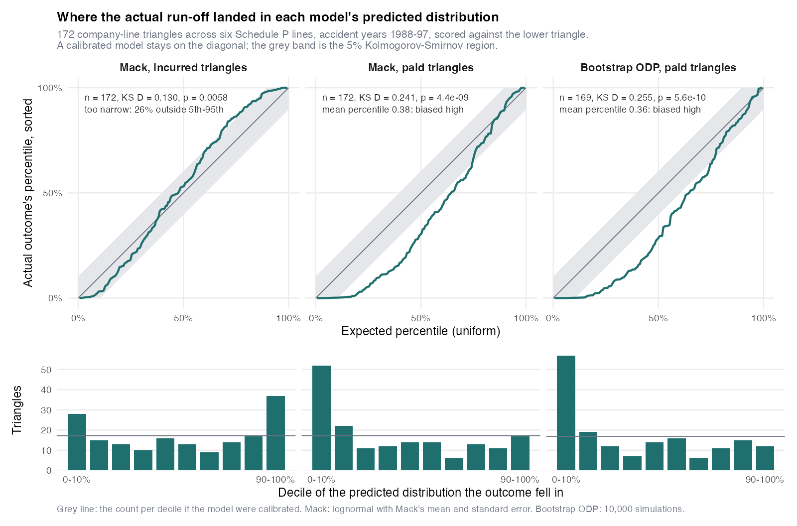
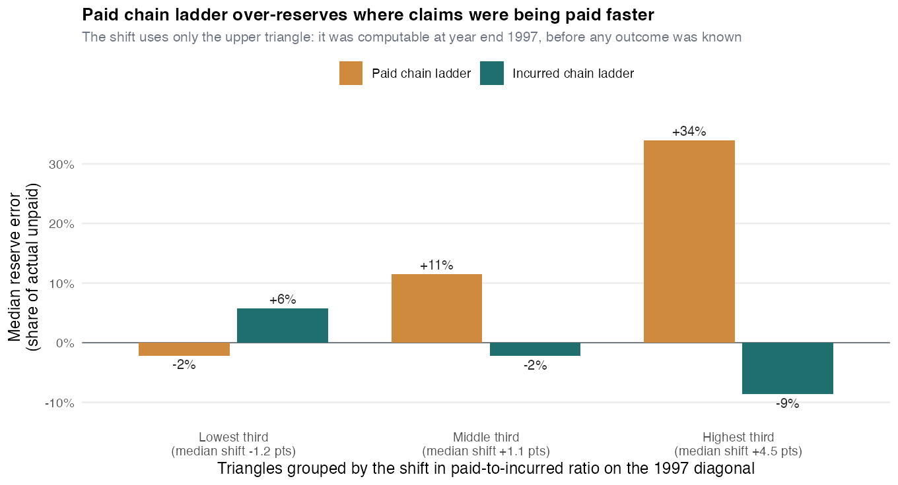
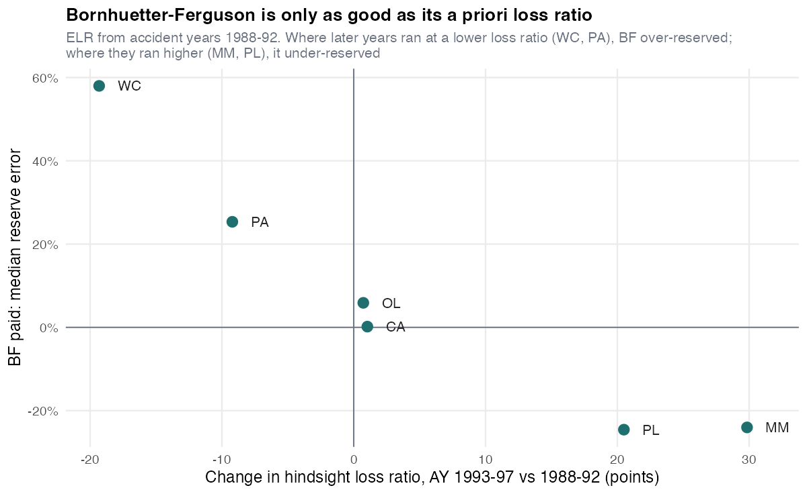
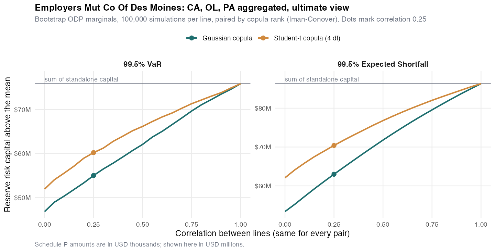

# Stochastic Loss Reserving and Reserve Risk Capital

Chain ladder, Bornhuetter-Ferguson, Mack and bootstrap ODP reserving in R on the **CAS Loss Reserving Database**: NAIC Schedule P triangles for six lines of business, accident years 1988-1997, together with the lower triangle that shows what each company actually went on to pay. Because the outcomes are known, the predicted reserve distributions can be scored, not just produced. The distributions are then turned into 99.5% VaR and Expected Shortfall reserve capital for a multi-line insurer, with lines aggregated through Gaussian and Student-t copulas.

The headline is not a reserve estimate. It is that the ranges the two standard stochastic models put around the reserve did not hold up. Across 172 company triangles, the actual outcome fell beyond Mack's 99.5th percentile (incurred data) in **4.1%** of cases, eight times the 0.5% the model promises. Both paid models were biased high: the average outcome sat at the 36th to 38th percentile of their predicted distributions instead of the 50th. The paid bias is concentrated in triangles whose paid-to-incurred ratio was rising, the signature of faster claim settlement, and that diagnostic could have been computed at year end 1997.



## Results

Each model predicts the distribution of the lag-10 total for a triangle; the backtest records the percentile at which the actual lag-10 total fell. A calibrated model produces percentiles that are uniform across triangles.

| Model | Triangles | KS D | KS p | Mean percentile | Outside 5th-95th | Beyond 99.5th |
|---|---|---|---|---|---|---|
| Mack, incurred | 172 | 0.130 | 0.006 | 0.53 | 25.6% | 7 (4.1%) |
| Mack, paid | 172 | 0.241 | 4e-9 | 0.38 | 31.4% | 4 (2.3%) |
| Bootstrap ODP, paid | 169 | 0.255 | 6e-10 | 0.36 | 31.4% | 4 (2.4%) |
| *A calibrated model* | | *< 0.104* | *> 0.05* | *0.50* | *10%* | *0.5%* |

Two different failures. Mack on incurred data is right on average (mean percentile 0.53) but too narrow: a quarter of outcomes land outside the 5th-95th range that should hold 90% of them, and the 99.5th percentile is breached at eight times the nominal rate (95% interval 1.7% to 8.2%). The paid models are biased high, with 52 and 57 outcomes in the bottom decile against about 17 expected. These are the same two shapes Meyers (2015) found. The samples overlap heavily (155 of the 172 triangles are among his 200), so this shows the result holds under one uniform screen and with product liability and medical malpractice added; it is not an independent confirmation.

By line (KS D; * rejected at 5%):

| Line | Triangles | Mack, incurred | Mack, paid | Bootstrap ODP, paid |
|---|---|---|---|---|
| Private passenger auto | 44 | 0.149 | 0.482* | 0.477* |
| Commercial auto | 46 | 0.176 | 0.241* | 0.232* |
| Workers' compensation | 25 | 0.269* | 0.410* | 0.399* |
| Other liability | 44 | 0.180 | 0.099 | 0.119 |
| Product liability | 7 | 0.299 | 0.251 | 0.204 |
| Medical malpractice | 6 | 0.282 | 0.446 | 0.378 |

Bootstrap counts are one lower for commercial auto and two lower for other liability, where the bootstrap failed (see [Bootstrap stability](#bootstrap-stability)). Personal auto and workers' compensation drive the paid failure; other liability passes on paid data (p = 0.74 Mack, 0.55 ODP). Product liability and medical malpractice have 7 and 6 usable triangles, so the test has almost no power there; they are listed for completeness. Full table, including p-values: [`outputs/tables/04_uniformity_tests.csv`](outputs/tables/04_uniformity_tests.csv).

## Checking the implementation: Meyers (2015) replicated

Meyers' monograph lists the 200 triangles he used. Running this repo's code on exactly those triangles reproduces his Kolmogorov-Smirnov statistics (his definition, in percent):

| Model | CA | PA | WC | OL | All four lines |
|---|---|---|---|---|---|
| Mack, incurred | 16.4 / 16.8 | 14.7 / 14.7 | 25.0 / 26.7 | 14.2 / 14.2 | 15.4 / 16.1 |
| Mack, paid | 20.3 / 21.2 | 48.3 / 48.3 | 32.4 / 31.4 | 10.6 / 10.8 | 24.9 / 25.4 |
| Bootstrap ODP, paid | 19.1 / 21.3 | 48.3 / 48.3 | 29.1 / 32.8 | 12.1 / 11.9 | 25.6 / 27.7 |

*Meyers (2015) / this repo.* The accept or reject verdict agrees in 14 of 15 cells. The exception is commercial auto under the bootstrap, borderline in both (19.1 against a critical value of 19.2 in the monograph; 21.3 against 19.8 here). Remaining differences come from a newer ChainLadder release, different random draws, and triangles the current package cannot fit (1 Mack incurred, 2 Mack paid and 16 bootstrap fits out of the 200; see [Bootstrap stability](#bootstrap-stability)).

## Why the paid models over-reserve

Paid chain ladder assumes every accident year pays out on the same schedule as the older ones. If claims are being settled faster, recent years have already paid more of their ultimate than the history implies, and multiplying them by the old development factors overshoots. Meyers reached the same diagnosis for this database and built a changing settlement rate model for it.

The tell is a paid-to-incurred ratio that drifts upward across accident years at the same age. The **P/I shift** used here is the paid-to-incurred ratio on the 1997 diagonal minus the average of the older accident years at the same lag, averaged over lags 1-8. It uses only the upper triangle, so an actuary could have computed it in early 1998.



Its Spearman correlation with the paid chain ladder error is 0.50 across the 172 triangles. In the lowest third, paid chain ladder is unbiased (median error -2%) and the paid models' outcome percentiles average 0.54 and 0.57. In the highest third it over-reserves by a median 34%, and the average percentile falls to 0.22 and 0.23. Incurred chain ladder errs the other way as the shift grows (+6% to -9%), consistent with part of the shift being weaker case reserves rather than faster payment. Berquist and Sherman (1977) adjust the triangle itself for both effects using claim counts; Schedule P has no counts, so here it stays a diagnostic.

One triangle shows it plainly. Federal Insurance's personal auto book, third-highest shift of the 172 and by far the largest of the top five, had a paid-to-incurred ratio at the end of the first year of 0.25 to 0.35 for accident years 1988-94, then 0.54 and 0.62 for 1996 and 1997. With hindsight, accident year 1997 paid 47% of its lag-10 amount in its first year, against 21% for 1988. Paid chain ladder set a reserve of $368M; incurred chain ladder, $126M; the company went on to pay $138M through lag 10. Mack on paid data put the actual outcome at essentially the 0th percentile, Mack on incurred at the 85th.

## Chain ladder against Bornhuetter-Ferguson

Point estimates on the same 172 triangles, errors as a share of the amount actually still unpaid at year end 1997:

| Method | Median error | Median absolute error | Dollar-weighted error | Over-reserved |
|---|---|---|---|---|
| Chain ladder, paid | +12.5% | 24.5% | +10.9% | 66% |
| Bornhuetter-Ferguson, paid | +16.7% | 30.2% | +18.8% | 64% |
| Chain ladder, incurred | -0.7% | 19.2% | +0.8% | 48% |
| Bornhuetter-Ferguson, incurred | +0.1% | 19.9% | +5.7% | 50% |

Bornhuetter-Ferguson did not help, and the reason is visible by line. Its a priori loss ratio comes from accident years 1988-92, and the hindsight loss ratio moved sharply between those years and 1993-97. Workers' compensation fell from 75% to 56%, and BF over-reserved it by a median 58%; medical malpractice rose from 64% to 94%, and BF under-reserved it by 24%. Where the loss ratio held (commercial auto 66% to 67%, other liability 70% to 71%), BF on paid data was within 6% at the median. Even on the most recent accident year, where BF is supposed to earn its keep, its median absolute error was larger (20% against 16% on paid, 17% against 13% on incurred).



BF is only as good as its a priori. An ELR taken from old accident years needs rate change and trend adjustments, which Schedule P does not report.

## Reserve risk capital

One company, chosen by rule: three or more lines in the screened sample, a stable bootstrap on every line, and the least concentrated reserve. That is **Employers Mutual Co. of Des Moines** (NAIC group 620): personal auto, commercial auto and other liability, with the largest line at 44% of the chain ladder reserve. Marginals are the bootstrap ODP distributions on paid data, 100,000 simulations per line. USD millions (Schedule P reports in thousands):

| Line | Mean reserve | CV | 99.5% VaR capital | 99.5% ES capital | One-year / ultimate | Actual outcome |
|---|---|---|---|---|---|---|
| Personal auto | 70.7 | 6.0% | 11.0 | 12.4 | 0.84 | 30th percentile |
| Commercial auto | 100.3 | 9.6% | 27.0 | 30.8 | 0.81 | 14th percentile |
| Other liability | 134.3 | 9.9% | 37.9 | 43.1 | 0.79 | 96th percentile |
| **Sum** | **305.2** | | **75.9** | **86.3** | | |

Capital is the amount above the mean reserve. Lines are aggregated by reordering (Iman and Conover 1982): each line keeps exactly its own simulated values, and the copula decides only which values occur together. Aggregate capital, with the diversification benefit against the sum of standalone capital in parentheses:

| Correlation | VaR, Gaussian | VaR, t (4 df) | ES, Gaussian | ES, t (4 df) |
|---|---|---|---|---|
| 0 | 46.8 (38%) | 51.9 (32%) | 53.4 (38%) | 62.1 (28%) |
| 0.25 | 55.0 (28%) | 60.2 (21%) | 63.0 (27%) | 70.4 (18%) |
| 0.5 | 62.1 (18%) | 66.2 (13%) | 71.8 (17%) | 76.8 (11%) |
| 1 | 75.9 (0%) | 75.9 (0%) | 86.3 (0%) | 86.3 (0%) |



At a correlation of 0.25, diversification cuts 99.5% VaR capital by 28% under a Gaussian copula and by 21% under a t copula. At the same correlation the t copula needs 9% more capital (11% at zero correlation): the shared mixing variable makes large losses arrive together even when the correlation parameter is zero, which a Gaussian copula cannot do.

**Which correlation?** The data do not pin it down. For the companies with two or more lines in the sample (42 on incurred, 41 on paid), the rank correlation between the outcome percentiles of a company's lines converts to 0.22 on incurred (95% interval -0.01 to 0.43) and about zero on paid (-0.18 to 0.17). That measure sees company-specific co-movement but not a shock that hits every insurer at once, so it is a floor rather than an estimate. 0.25 is a reference point; the figure covers the whole range.

**Ultimate view against the Solvency II one-year view.** Everything above is the ultimate view: all future payments to lag 10, which is what the backtest scores. Solvency II measures reserve risk over one year (99.5% VaR; the Swiss Solvency Test uses 99% ES): next year's payments plus the best estimate re-made at the end of that year, when only one more diagonal is known. From the same bootstrap, re-reserving on each simulated next diagonal ("actuary in the box"), one-year VaR capital is 79% to 84% of the ultimate figure by line and 80% in aggregate. The Merz-Wüthrich formula, the analytic one-year counterpart of Mack, gives a standard error 77% to 80% of Mack's. The rest of the uncertainty is still there; it emerges after the first year.

**Read the capital through the backtest.** On these data the bootstrap's own 99.5th percentile was exceeded in 2.4% of triangles, about five times the nominal rate (95% interval 0.6% to 5.9%). For this company the realised total landed at the 73rd percentile of the aggregate distribution, but a capital number from these models should carry an explicit allowance for model error.

## What this project does

**Data and screening (`R/01_prepare_data.R`).** Paid is Schedule P Part 3 cumulative paid loss and DCC; incurred is Part 2 incurred less Part 4 bulk and IBNR, i.e. reported incurred, as in Meyers (2015). "Ultimate" means development lag 10 throughout; no tail factor. Screening, in order, following Meyers' logic that a change in volume or in reinsurance signals a change in operations:

| Rule | Company-lines left |
|---|---|
| In the database (six lines) | 779 |
| Net and direct earned premium positive in all ten accident years | 453 |
| Every upper-triangle cell of paid and incurred positive, and the paid triangle still developing after 1997 | 338 |
| Coefficient of variation of net earned premium below 0.40 | 225 |
| Coefficient of variation of the net-to-direct premium ratio below 0.125 | **172** |

Meyers tuned his limits by line to get 50 insurers in each of four lines. 0.40 and 0.125 are his limits for commercial auto and other liability, rounded (0.399 and 0.390 on premium; personal auto used 0.45, workers' compensation 0.95 and 0.20), applied uniformly to all six lines and fixed before any model was run. The final sample is 44 personal auto, 46 commercial auto, 25 workers' compensation, 44 other liability, 7 product liability and 6 medical malpractice triangles. Every rule uses only information available at year end 1997.

**Deterministic methods (`R/02_deterministic.R`).** Volume-weighted chain ladder (cross-checked against `ChainLadder::chainladder` on every triangle) and Bornhuetter-Ferguson with the a priori ELR set to the premium-weighted chain ladder loss ratio of accident years 1988-92.

**Stochastic methods (`R/03_stochastic.R`).** Mack on paid and incurred triangles, with a lognormal matched to Mack's mean and standard error as the predictive distribution (Mack's own suggestion, and Meyers' choice). Bootstrap ODP (England and Verrall 2002) on paid triangles, 10,000 simulations each with gamma process error. Not on incurred: the ODP variance is proportional to the mean, so it needs non-negative incremental losses, and incurred incrementals go negative whenever case reserves are released.

**Backtest (`R/04_backtest.R`).** Percentile of each actual outcome, Kolmogorov-Smirnov test and p-p plot by model and line, exceedance of the 99.5th percentile with a Clopper-Pearson interval, the replication on Meyers' 200 triangles, the paid-to-incurred diagnostic, and the cross-line dependence of outcome percentiles.

**Capital (`R/05_capital.R`).** Standalone and aggregate 99.5% VaR and ES above the mean, ultimate and one-year views, Gaussian and t copulas over a grid of correlations.

### Bootstrap stability

`BootChainLadder` has two failure modes on small triangles, which the pipeline catches rather than hides:

1. If a development column nets to exactly zero (a link ratio of exactly 1.000) while cells inside it move, a fitted incremental of zero gives an infinite Pearson residual, the scale parameter becomes infinite, and every simulated reserve comes back as zero. Three screened triangles (16 of Meyers' 200) are dropped from the bootstrap results for this.
2. A large negative residual resampled into a small early cell can push a pseudo-triangle to zero or below, and that simulation's projection explodes. This happened at least once in 68 of the 169 bootstrapped triangles, mostly other liability and commercial auto, where first-year payments are small.

Re-running the paid verdict on the 101 triangles with no invalid pseudo-triangle makes it stronger, not weaker (KS D 0.35, mean percentile 0.31 for both paid models), so the conclusion does not rest on the unstable ones. The capital company is required to have none: Federal Insurance's product liability line, for example, produced invalid pseudo-triangles in 58% of simulations, and an ES computed on it would mostly be measuring those explosions.

## Limitations

- **One era.** The workers' compensation loss ratio in this sample fell 19 points between accident years 1988-92 and 1993-97, and claims were being settled faster (Meyers' finding, and the P/I shift here). The conclusions are about these models on this data. The CAS has since published the same database for accident years 1998-2007; rerunning the backtest there is the obvious next step.
- **Lag 10 is not ultimate** for workers' compensation, medical malpractice and other liability. Models and outcomes are compared at lag 10 consistently, but reserves at lag 10 still carry tail exposure that nothing here measures.
- **Net of reinsurance, group level.** Schedule P triangles are net; intra-group pooling and reinsurance changes can move a triangle for reasons unrelated to claims. The premium screens catch the large changes only.
- **No claim counts**, so no Berquist-Sherman adjustment or frequency-severity method, only the diagnostic.
- **Small samples** for product liability (7) and medical malpractice (6).
- **Capital is illustrative**: one company, undiscounted, no risk margin, an exchangeable correlation the data cannot estimate, and no explicit allowance for the model error the backtest finds.
- **Not done:** Meyers' Bayesian models (correlated chain ladder on incurred, changing settlement rate on paid), which he shows largely fix both failures; the settlement rate model still fails on personal auto.

## Repository structure

```
R/
  00_common.R          paths, triangle helpers, percentile/KS, VaR/ES, copula sampler
  01_prepare_data.R    load six lines, build triangles, screen
  02_deterministic.R   chain ladder, Bornhuetter-Ferguson, error against actual run-off
  03_stochastic.R      Mack (paid, incurred), bootstrap ODP (paid), outcome percentiles
  04_backtest.R        KS tests, 99.5% exceedance, Meyers replication, P/I diagnostic
  05_capital.R         VaR/ES capital, one-year vs ultimate, copula aggregation
  06_figures.R         README figures (reads the CSVs, refits nothing)
  run_all.R            full pipeline
scripts/
  download_data.sh     fetch the six CAS files into data/raw/
data/reference/
  meyers2015_groups.csv  the 200 triangles in Meyers (2015), Table 12
tests/
  test_helpers.R       checks on the hand-written helpers against known answers
outputs/
  tables/              every number quoted above, as CSV
  figures/             the four figures above
```

## How to run

R 4.4+ with `ChainLadder`, `data.table`, `ggplot2`, `patchwork`, `scales` (tested with R 4.5.2 and ChainLadder 0.2.21):

```bash
Rscript -e 'install.packages(c("ChainLadder","data.table","ggplot2","patchwork","scales"))'
```

Then:

```bash
bash scripts/download_data.sh
Rscript R/run_all.R
Rscript tests/test_helpers.R
```

Under two minutes end to end, most of it the 10,000-simulation bootstrap on 217 triangles in step 03. Every random step is seeded.

## Data

CAS Loss Reserving Database, "Loss Reserving Data Pulled From NAIC Schedule P", compiled by Glenn Meyers and Peng Shi (the earlier data sets, updated September 1, 2011), accessed from the [CAS web page](https://www.casact.org/publications-research/research/research-resources/loss-reserving-data-pulled-naic-schedule-p) as the CAS asks users to acknowledge. The page states no redistribution licence, so the raw files are not committed; `scripts/download_data.sh` fetches them. Amounts are in USD thousands, net of reinsurance.

## References

- Berquist, J. R. and Sherman, R. E. (1977). Loss reserve adequacy testing: a comprehensive, systematic approach. *PCAS* 64.
- England, P. D. and Verrall, R. J. (2002). Stochastic claims reserving in general insurance. *British Actuarial Journal* 8(3).
- Iman, R. L. and Conover, W. J. (1982). A distribution-free approach to inducing rank correlation among input variables. *Communications in Statistics: Simulation and Computation* 11(3).
- Mack, T. (1993). Distribution-free calculation of the standard error of chain ladder reserve estimates. *ASTIN Bulletin* 23(2).
- Merz, M. and Wüthrich, M. V. (2008). Modelling the claims development result for solvency purposes. *CAS E-Forum*, Fall 2008.
- Meyers, G. (2015). *Stochastic Loss Reserving Using Bayesian MCMC Models.* CAS Monograph No. 1.

## Context

Built by Dillon (Tsun-Chun) Chang, UCLA Anderson Master of Financial Engineering 2026 — [linkedin.com/in/tsun-chun-chang](https://www.linkedin.com/in/tsun-chun-chang/).
